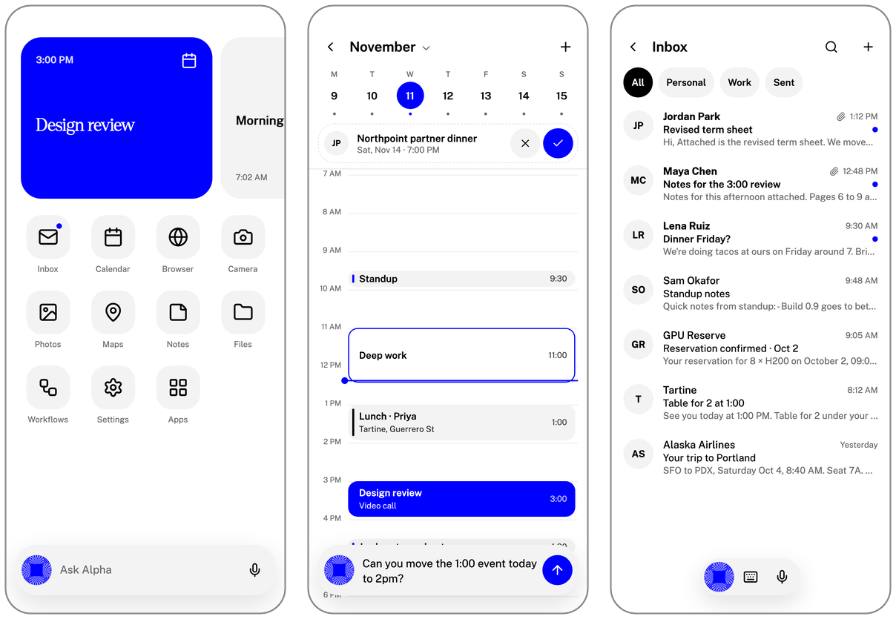
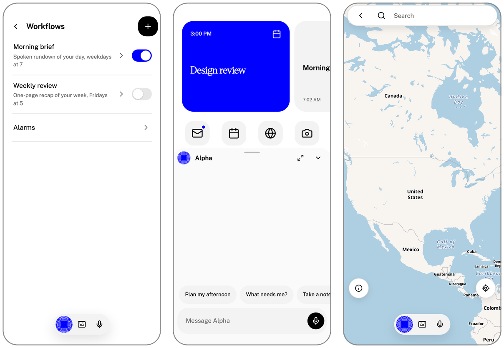

<p align="center">
  <a href="https://alphacompute.ai">
    <picture>
      <source media="(prefers-color-scheme: dark)" srcset="docs/assets/alpha-compute-logo-dark.svg">
      
    </picture>
  </a>
</p>

<h1 align="center">Alpha</h1>

<p align="center">
  <b>The phone with its own AI agent.</b><br>
  Built by <a href="https://alphacompute.ai">Alpha Compute</a>.
</p>

<p align="center">
  <a href="https://alphacompute.ai"></a>
  <a href="#status"></a>
</p>

<p align="center">
  <a href="#quickstart">Quickstart</a> ·
  <a href="#what-you-get">What you get</a> ·
  <a href="#how-it-works">How it works</a> ·
  <a href="#put-it-on-a-phone">Android</a> ·
  <a href="docs/development.md">Developer guide</a> ·
  <a href="https://alphacompute.ai">Website</a>
</p>

<p align="center">
  
</p>

Alpha is an Android home screen and app suite with a personal AI agent that lives
on the phone itself. Tap **Ask Alpha**, type or talk, and the agent works across
your mail, calendar, maps, notes, photos and files. It asks before it does
anything that matters.

**Your agent stays with you.** The agent, its memory and its database run on your
device, not on someone else's server. Speech uses your configured provider or
eligible Eliza Cloud access, with local speech otherwise and as a fallback. A
cloud account supplies services such as model inference, speech and Gmail.

## Quickstart

Try Alpha in your browser. You need [Git](https://git-scm.com) and
[Node.js 26](https://nodejs.org) (`nvm install` picks the right version from
`.nvmrc`). No Android tools and no account are required.

```bash
git clone --recurse-submodules https://github.com/alphacompute/alpha.git
```

```bash
cd alpha && npm ci
```

```bash
npm run dev:ui
```

Open the address it prints (usually <http://127.0.0.1:5173>) and you are on
Alpha's Home screen. Narrow the window to phone width for the best view.

> [!TIP]
> Forgot `--recurse-submodules`? Run `git submodule update --init --recursive`
> inside the folder, then `npm ci` again.

### Next steps

| I want to…                              | Run                 | You also need                              |
| --------------------------------------- | ------------------- | ------------------------------------------ |
| Look around the interface               | `npm run dev:ui`    | Nothing else                               |
| Run the agent on my computer            | `npm run dev`       | [Bun 1.4.2](https://bun.sh)                |
| Sign in and use real Cloud services     | `npm run dev:cloud` | Bun, and an Eliza Cloud account            |
| Check my changes before a pull request  | `npm run verify`    | JDK 21 and the `sqlite3` command-line tool |
| Build the Android app                   | [See below](#put-it-on-a-phone) | JDK 21 and the Android SDK     |

## What you get

<table>
<tr><td><b>An agent that lives on your phone</b></td><td>The agent, its tools and its history stay on the device. There is no hosted copy of your agent to pair with or provision.</td></tr>
<tr><td><b>Ask Alpha, anywhere</b></td><td>One bar at the bottom of every screen. Type, dictate into an editable draft, or hold a spoken conversation you can interrupt at any time.</td></tr>
<tr><td><b>On-device voice</b></td><td>Local speech is always available. Speech uses the owner's configured provider or eligible Eliza Cloud access; network speech that fails before playback falls back to local speech.</td></tr>
<tr><td><b>Everyday apps, built in</b></td><td>Inbox (Gmail), Calendar, Browser, Camera, Photos, Maps, Notes and Files, all designed around the agent.</td></tr>
<tr><td><b>Workflows</b></td><td>Scheduled briefs and routines that run while the phone is on, with approvals and a run history you can inspect.</td></tr>
<tr><td><b>You approve what matters</b></td><td>The agent shows you what it is about to do and waits for your go-ahead. Full photo access stays a local permission, not a bulk upload.</td></tr>
<tr><td><b>An app or a whole phone</b></td><td>Install Alpha as a normal app, set it as your launcher, or run the Alpha OS image, which adds Phone, Contacts and SMS.</td></tr>
</table>

<p align="center">
  
</p>

## How it works


- **Alpha** is the interface: Home, the built-in apps and the Ask Alpha bar.
- **The resident agent** runs on the phone. It plans, calls tools, remembers and
  schedules.
- **Eliza Cloud** supplies managed services: model inference, your subscription,
  Gmail, and optional Google Calendar and Maps. It never hosts your agent.

Local speech does not mean an offline language model: text inference is hosted,
and Alpha tells you what context a request sends.

## Put it on a phone

You need JDK 21 and the Android SDK (platform 36, build-tools 36.0.0), with
`JAVA_HOME` and `ANDROID_HOME` set.

```bash
npm run android:build:inputs
```

```bash
npm run android:build:local
```

```bash
npm run android:verify
```

The first command lists anything that is missing. The second prepares the agent
and builds the APKs into `artifacts/`. The third checks their contents and
signatures.

On-device voice needs recorded model files and native outputs that the build
does not download for you. Stage the reviewed inputs first with
`node scripts/android-stage-voice-models.ts --from <directory>`. Developer APKs
can explicitly omit the runtime; those builds are not distributable. Setup,
signing and emulator testing are covered in the
[developer guide](docs/development.md#android-builds).

| Variant        | What it is                                                        |
| -------------- | ----------------------------------------------------------------- |
| **Standalone** | Alpha as a regular Android app, next to your current home screen. |
| **Launcher**   | Alpha as your home screen.                                        |
| **Alpha OS**   | A full phone image. Adds Phone, Contacts and SMS/MMS.             |

## Status

Alpha is in **early pilot**.

- There is no app-store or APK download yet. To try it today, use the
  [Quickstart](#quickstart) or build from source.
- Alpha OS updates are published for enrolled Pixel pilot devices only.
- Wallet, passkeys, Telegram and Discord are not part of the first release.
- Some requirements in the [PRD](docs/prd.md) are still being built. A passing
  build is not a claim about real devices: APK builds, emulator runs, full image
  boots, live integrations and hands-on acceptance are tracked separately.

## Documentation

| Goal                                       | Start here                                                        |
| ------------------------------------------ | ----------------------------------------------------------------- |
| Set up, run and test locally               | [Developer guide](docs/development.md#setup)                      |
| Build, sign and verify Android APKs        | [Android builds](docs/development.md#android-builds)              |
| Test on an emulator or stage an OS image   | [Device and image tooling](docs/development.md#device-and-image-tooling) |
| Understand what Alpha is meant to do       | [Product requirements](docs/prd.md)                               |
| Work on the code with an AI coding agent   | [AGENTS.md](AGENTS.md)                                            |

## Project layout

| Path           | What lives there                                                    |
| -------------- | ------------------------------------------------------------------- |
| `apps/app`     | The Alpha interface: Home, the built-in apps and Ask Alpha.         |
| `android`      | Android packaging, native code and the Alpha OS image pieces.       |
| `scripts`      | Build, test and release tooling.                                    |
| `specs`        | Formal models of the trickiest behaviour, checked on every verify.  |
| `vendor/eliza` | The pinned [elizaOS](https://github.com/elizaOS/eliza) runtime. Read-only here. |

## Contributing

Issues and pull requests are welcome.

1. Fork the repository and create a branch.
2. Make your change. Shared runtime changes belong upstream in elizaOS, not in
   `vendor/eliza`.
3. Run `npm run verify`. If you touched Android, also run
   `npm run android:build:local`.
4. Open a pull request that says what you changed and how you tested it.

Found a security problem? Please do not open a public issue. Contact the team
through [alphacompute.ai](https://alphacompute.ai).

## Credits

Alpha is built by [Alpha Compute](https://alphacompute.ai) on the open-source
[elizaOS](https://github.com/elizaOS/eliza) agent runtime. Licence texts for
bundled third-party software are in [`licenses/`](licenses).
