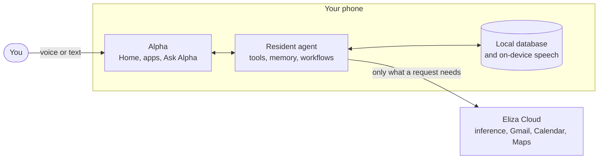

<p align="center">
  <a href="https://alphacompute.ai">
    <picture>
      <source media="(prefers-color-scheme: dark)" srcset="docs/assets/alpha-compute-logo-dark.svg">
      
    </picture>
  </a>
</p>

<h1 align="center">Alpha</h1>

<p align="center">
  <b>A complete mobile agentic operating system.</b><br>
  Built by <a href="https://alphacompute.ai">Alpha Compute</a>.
</p>

<p align="center">
  <a href="#quickstart">Quickstart</a> ·
  <a href="#what-you-get">What you get</a> ·
  <a href="#how-it-works">How it works</a> ·
  <a href="#put-it-on-a-phone">Android</a> ·
  <a href="docs/development.md">Developer guide</a> ·
  <a href="https://alphacompute.ai">Website</a>
</p>

<p align="center">
  
</p>

Alpha is a personal AI agent that lives on the phone itself. Tap **Ask Alpha**, type or talk, and the agent works across your mail, calendar, maps, notes, photos and files. It asks before it does anything that matters.

**Your agent stays with you.** The agent, its memory and its database run on your device, not on someone else's server. Speech uses your configured provider or eligible cloud access, with local speech otherwise and as a fallback. A cloud account supplies services such as model inference, speech and Gmail.

## Quickstart

```bash
git clone --recurse-submodules https://github.com/eliza-research/alpha.git
```

```bash
cd alpha && bun install --frozen-lockfile
```

```bash
bun run dev:ui
```

> [!TIP]
> Forgot `--recurse-submodules`? Run `git submodule update --init --recursive`
> inside the folder, then `bun install --frozen-lockfile` again.

## What you get

<table>
<tr><td><b>An agent that lives on your phone</b></td><td>The agent, its tools and its history stay on the device. There is no hosted copy of your agent to pair with or provision.</td></tr>
<tr><td><b>Ask Alpha, anywhere</b></td><td>One bar at the bottom of every screen. Type, dictate into an editable draft, or hold a spoken conversation you can interrupt at any time.</td></tr>
<tr><td><b>On-device voice</b></td><td>Local speech is always available. Speech uses the owner's configured provider or eligible Eliza Cloud access; network speech that fails before playback falls back to local speech.</td></tr>
<tr><td><b>Everyday apps, built in</b></td><td>Inbox (Gmail), Calendar, Browser, Camera, Photos, Maps, Notes and Files, all designed around the agent.</td></tr>
<tr><td><b>Workflows</b></td><td>Scheduled briefs and routines that run while the phone is on, with approvals and a run history you can inspect.</td></tr>
<tr><td><b>You approve what matters</b></td><td>The agent shows you what it is about to do and waits for your go-ahead. Full photo access stays a local permission, not a bulk upload.</td></tr>
</table>

<p align="center">
  
</p>

## How it works



- **Alpha** is the interface: Home, the built-in apps and the Ask Alpha bar.
- **The resident agent** runs on the phone. It plans, calls tools, remembers and
  schedules.
- **Eliza Cloud** supplies managed services: model inference, your subscription,
  Gmail, and optional Google Calendar and Maps. It never hosts your agent.

Local speech does not mean an offline language model: text inference is hosted,
and Alpha tells you what context a request sends.

## Put it on a phone

You need JDK 21, Python 3 for toolchain bootstrapping, and the Android SDK
(platform 36, build-tools 36.0.0), with `JAVA_HOME` and `ANDROID_HOME` set.

```bash
bun run android:build:inputs
```

```bash
bun run android:build:local
```

```bash
bun run android:verify
```

The first command lists anything that is missing. The second prepares the agent
and builds the APKs into `artifacts/`. The third checks their contents and
signatures.

The first build downloads the pinned models and toolchain inputs, builds the
native voice and embedding libraries, and caches the verified outputs. Later
builds reuse that cache after checking its source recipe and file hashes.
There is one launcher product/flavor with the resident runtime and on-device
voice in every APK. The build keeps debug, release and instrumentation artifacts
separate; only the launcher release is a distribution APK. Setup, signing and emulator testing are covered in the
[developer guide](docs/development.md#android-builds).

| Form         | What it is                                            |
| ------------ | ----------------------------------------------------- |
| **Launcher** | Alpha as your home screen.                            |
| **Alpha OS** | A full phone image. Adds Phone, Contacts and SMS/MMS. |

## Contributing

Issues and pull requests are welcome.

1. Fork the repository and create a branch.
2. Make your change. Shared runtime changes belong upstream in elizaOS, not in
   `vendor/eliza`.
3. Run `bun run verify`. If you touched Android, also run
   `bun run android:build:local`.
4. Open a pull request that says what you changed and how you tested it.

Found a security problem? Please do not open a public issue. Contact the team
through [alphacompute.ai](https://alphacompute.ai).

## Credits

Alpha is built by [Alpha Compute](https://alphacompute.ai) on the open-source
[elizaOS](https://github.com/elizaOS/eliza) agent runtime. Licence texts for
bundled third-party software are in [`licenses/`](licenses).
